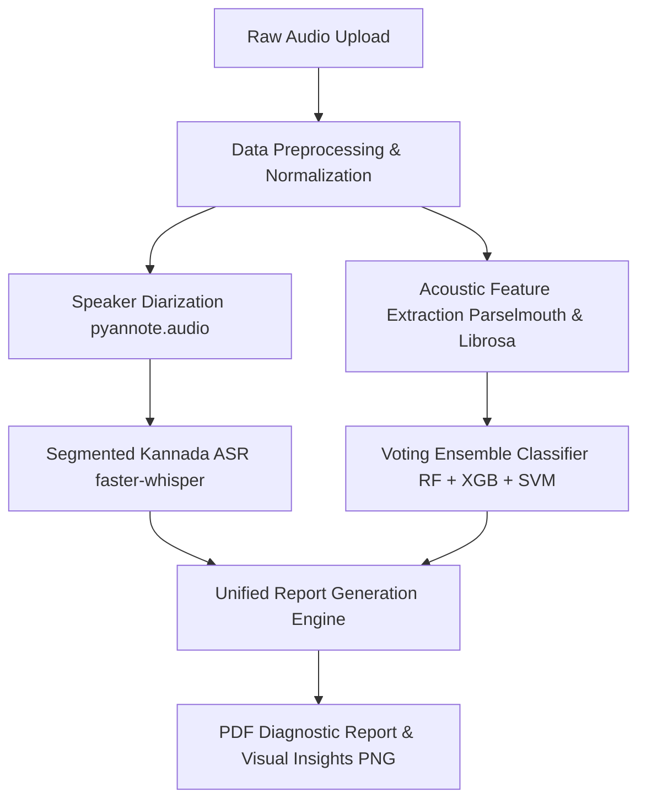

# Technical Documentation: Automated Speech Diagnostic Engine (SpeakSense)

This document details the system design, model architecture, and scientific justifications of the **SpeakSense** speech diagnostic pipeline.

---

## 1. Executive Summary & Design Goals
The **SpeakSense** system is designed to perform advanced acoustic profiling, speaker separation (diarization), multilingual automatic speech recognition (Kannada), and clinical speech classification (Age, Gender, and Typicality) from raw audio recordings.

The pipeline is built with the following core design patterns:
* **Modularity**: Separation of duties across extraction, segmentation, prediction, and reporting layers.
* **Clinical Rigidity**: Aligning acoustic parameter extraction with established speech pathology standards (using parameters like Jitter, Shimmer, and Harmonics-to-Noise Ratio).
* **Robust Fail-safes**: Hybrid modeling where machine learning ensembles work alongside deterministic fallback heuristics to guarantee diagnostic output even when training datasets are highly skewed or limited.

---

## 2. System Architecture
The application runs as a modular data pipeline, outlined below:



### Pipeline Details:
1. **Preprocessing & Normalization**: Standardizes sampling rates to 16,000 Hz, converts multi-channel audio to mono, and performs peak amplitude normalization to negate microphone distance variance.
2. **Diarization**: Employs pretrained Pyannote models to segment audio by unique speaker IDs with millisecond-precision timestamps.
3. **Kannada ASR**: Runs ASR locally using optimized GGML/CTranslate2 Whisper models (`faster-whisper`), mapping transcript segments directly to diarized speaker bounds.
4. **Feature Extraction**: Extracts vocal features concurrently using Librosa (spectral) and Praat-Parselmouth (fundamental frequency and perturbation).
5. **Voting Ensemble**: Computes final predictions using soft-voting averages from an ensemble of classifiers.
6. **Reporting Engine**: Synthesizes transcripts, ML classification predictions, and feature parameters into a ReportLab PDF and Matplotlib graphic file.

---

## 3. Acoustic Feature Engineering & Justification
To fulfill classification requirements, the engine extracts a 36-dimensional feature space. The parameters are divided into three distinct diagnostic tasks:

### A. Age Classification (Adult vs. Child)
Children have shorter vocal tracts and smaller vocal folds, resulting in higher fundamental frequencies and higher formants.
* **Fundamental Frequency ($F_0$)**: Mean, min, max, and standard deviation.
* **Formants ($F_1, F_2, F_3$)**: Tracks resonance peaks that correspond to vocal tract length.
* **Spectral Centroid & Bandwidth**: Identifies the center of mass and width of the spectrum, capturing the bright/sharp properties of children's voices.
* **MFCCs (1–13)**: Mel-Frequency Cepstral Coefficients capture overall spectral shape.

### B. Gender Classification (Male vs. Female)
* **$F_0$ Mean & Range**: The primary physical separator between male ($85-180\text{ Hz}$) and female ($165-255\text{ Hz}$) speakers.
* **Formants**: Capture structural vocal tract differences.
* **Zero-Crossing Rate (ZCR)**: Captures differences in unvoiced speech segments and breathiness.

### C. Typicality Classification (Typical vs. Atypical Speech)
Speech disorders (e.g., dysarthria, dysphonia) manifest as perturbation in vocal fold vibration and temporal disfluency.
* **Jitter (Local, RAP, PPQ5)**: Measures short-term cycle-to-cycle variation in fundamental frequency (vocal fold instability). Threshold: $> 1.04\%$.
* **Shimmer (Local, APQ3, APQ5)**: Measures cycle-to-cycle amplitude variation (vocal loudness instability). Threshold: $> 0.35\text{ dB}$.
* **Harmonics-to-Noise Ratio (HNR)**: Indicates overall voice quality and breathiness. A lower HNR indicates hoarseness or breathy speech. Threshold: $< 15\text{ dB}$.
* **Temporal Metrics (Voiced Fraction, Pause Count, Speech Rate)**: Captures hesitation, stuttering, or abnormally slow articulation rates.

---

## 4. Modeling Approach: ML Ensemble
Rather than relying on a single classifier, SpeakSense uses a **Voting Ensemble** containing three diverse mathematical approaches:
1. **Random Forest (RF)**: A bagging ensemble of decision trees. Excellent for capturing non-linear feature interactions and highly robust against outliers.
2. **XGBoost (XGB)**: A gradient boosting machine. Focuses sequentially on fixing residuals, maximizing prediction margins.
3. **Support Vector Machine (SVM)**: Uses a Radial Basis Function (RBF) kernel to project the features into high-dimensional space to isolate complex boundaries.

### Soft Voting:
The ensemble aggregates the class probabilities from each of the three models:
$$P(y = c | X) = \frac{1}{3} \sum_{m \in \{RF, XGB, SVM\}} P_m(y = c | X)$$
The class with the highest average probability is chosen. This significantly lowers variance, protects the model against single-classifier bias, and improves generalization on small datasets.

---

## 5. Setup & Execution Guide
The pipeline is designed to run in a localized virtual environment for reproducibility.

### Running Feature Extraction and Training:
```bash
# Run training on the processed datasets
python src/pipeline.py --train --data datasets/processed
```

### Running Inference on an Audio File:
```bash
# Runs diarization, transcription, extraction, and saves report
python src/pipeline.py --file sample.wav
```

### Generating Plots:
```bash
# Creates the pitch, intensity, and MFCC spectrogram plots
python src/visualize.py
```
